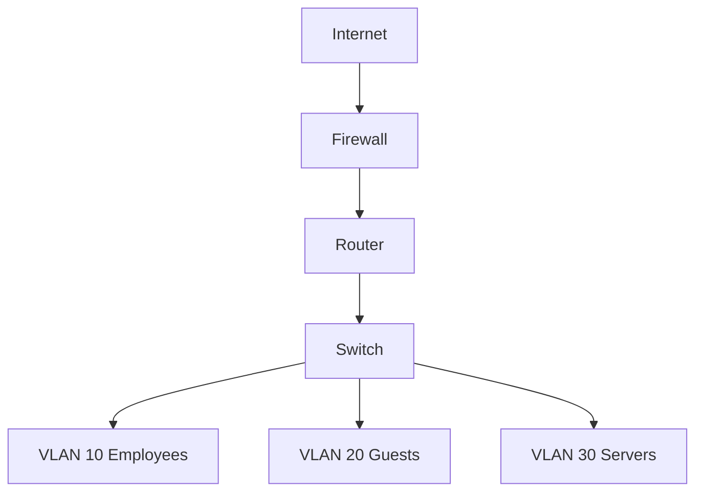

# Small Business IT Network Design

Design for a 25-person office.

| VLAN | Purpose | Subnet | Gateway |
|---|---|---|---|
| 10 | Employees | 192.168.10.0/24 | 192.168.10.1 |
| 20 | Guests | 192.168.20.0/24 | 192.168.20.1 |
| 30 | Servers | 192.168.30.0/24 | 192.168.30.1 |

## Security plan
Guest VLAN should not access employee or server networks. Allow approved employee-to-server services; restrict administration to IT hosts. Deny other inter-VLAN traffic by default.

## Cisco Packet Tracer lab
1. Add router, managed switch, and three PCs.
2. Assign switch access ports to VLANs 10, 20, 30.
3. Configure router-on-a-stick trunk and subinterfaces for gateways.
4. Set static IPs or DHCP pools, then test gateway reachability.
5. Add ACLs for guest isolation. Save the .pkt project and screenshots.
6. Record successful and failed pings, including expected blocked traffic.

## Troubleshooting
Check cables and link status, then IP/subnet/gateway, DHCP, ping gateway, DNS, routing and ACLs. Windows commands: `ipconfig /all`, `ping`, `tracert`, `nslookup`.

**Status:** design documented; simulation and test evidence pending.
